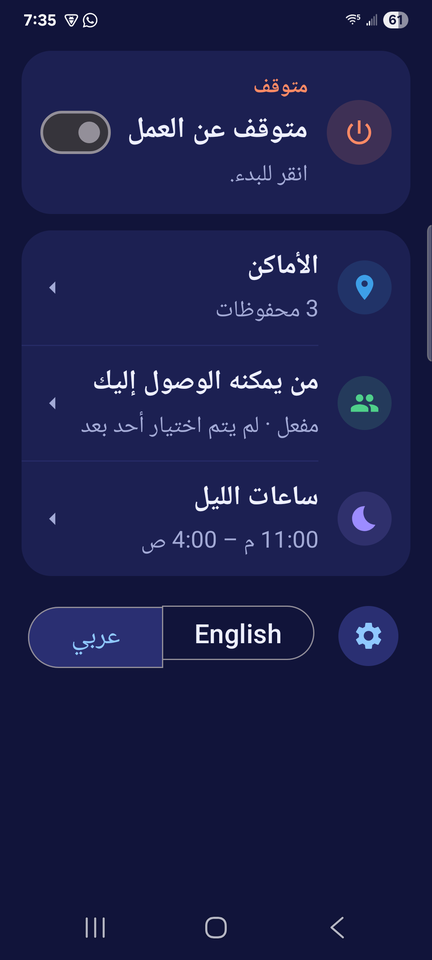
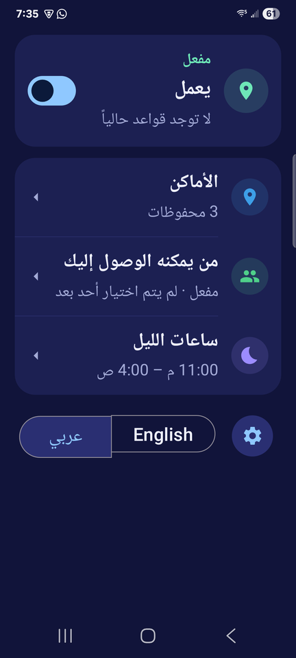
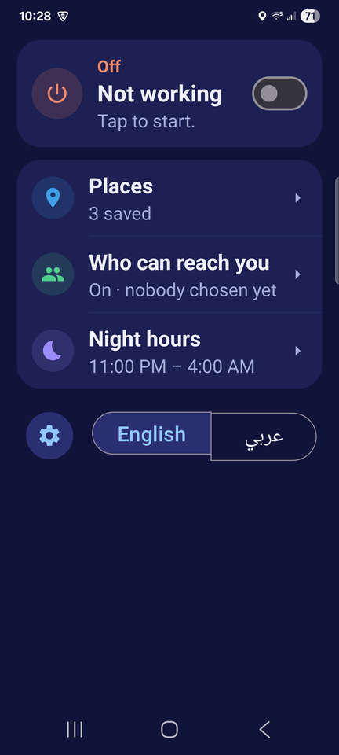
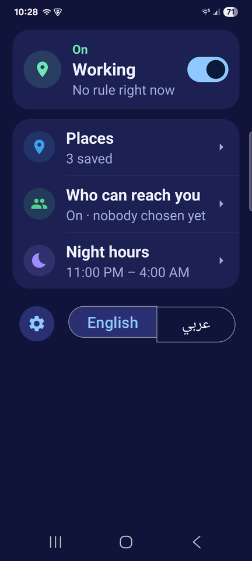
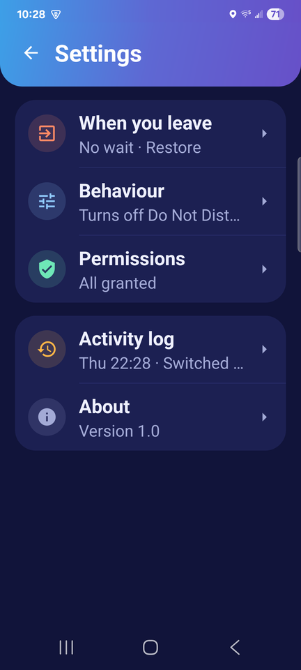
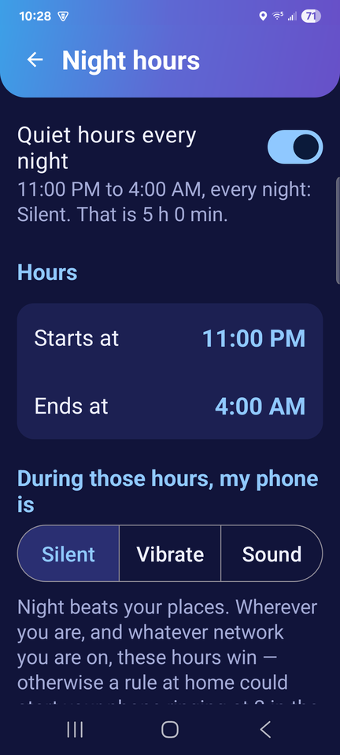

  

<h1 align="center">لا تزعجنا · Don't Bother</h1>

> [!CAUTION]
> 

>
> **مجاني للاستخدام الشخصي. الاستخدام التجاري غير مسموح به.**
>
> تطبيق "لا تزعجنا" مجاني تماماً. لا يجوز لك استخدام هذا التطبيق أو الكود المصدري الخاص به،
> كلياً أو جزئياً، لأي غرض تجاري دون إذن خطي مسبق مني. يتضمن ذلك بيعه، أو تضمينه في
> منتج مدفوع، أو استخدامه في عمل تجاري. قد يؤدي الاستخدام التجاري غير المعتمد إلى
> اتخاذ إجراءات قانونية.
>
> إذا كنت ترغب في استخدامه تجارياً، يرجى
> [التواصل معي أولاً](https://github.com/nandxorandor/dont-bother-app/issues).
>
> مرخص بموجب [ترخيص PolyForm غير التجاري 1.0.0](docs/LICENSE-ar.md).
>
> 

**لأن هاتفك ذكي، فلماذا لا يدير وضعه الصامت بنفسه؟**

كم مرة دخلت المسجد، واستعددت للصلاة، وفي منتصف الصلاة يرتفع صوت هاتف أحدهم بنغمة رنين
مزعجة؟ أو الأسوأ من ذلك — أنك تتذكر إسكاته، لكنك تنسى إعادة تشغيله لتفوتك مكالمات مهمة
طوال اليوم؟ جميعنا مررنا بهذه اللحظة المحرجة.

«لا تزعجنا» تطبيق أندرويد مجاني وخفيف، صُمم خصيصاً للتحكم التلقائي في وضع الرنين الخاص
بهاتفك (صامت، اهتزاز، صوت) بناءً على مكانك والوقت، وبدون أي تدخل يدوي منك. باللغتين
الإنجليزية والعربية.

## التحميل

حمّل ملف **`DontBother-1.0.apk`** من [صفحة الإصدار v1.0](https://github.com/nandxorandor/dont-bother-app/releases/tag/v1.0)، وافتحه على هاتفك (أندرويد 8.0 أو أحدث)، واسمح بتثبيت التطبيقات من هذا المصدر عندما يطلب أندرويد ذلك. ثم افتح التطبيق واتبع البطاقات الصفراء لمنح الأذونات التي يحتاجها.

## لقطات الشاشة

| متوقف | مفعل | ساعات الليل | الإعدادات |
|---|---|---|---|
|  |  |  |  |

| عندما تغادر | السلوك | الأذونات |
|---|---|---|
|  |  |  |

## كيف يعمل التطبيق بالتفصيل؟ (حالات الاستخدام)

التطبيق بُني بعناية ليغطي معظم السيناريوهات اليومية بسلاسة:

- **التحكم والتشغيل:**
  - **للتشغيل:** انقر على البطاقة في الأعلى، ومنذ تلك اللحظة سيبدأ التطبيق بتغيير صوت
    الهاتف تلقائياً.
  - **للإيقاف:** انقر مرة أخرى، سيتوقف عن العمل ويعيد هاتفك تماماً إلى الحالة التي كان
    عليها قبل أي قاعدة.
- **إدارة الأماكن (حيث يتغير وضع الهاتف):**
  - **أماكن تعتمد على الواي فاي (مثل المسجد إذا كانت تتوفر له شبكة وتعرف كلمة مرورها،
    المنزل، أو المكتب):** اختر الشبكة من القائمة، امنحها اسماً،
    وحدد الوضع المطلوب (صامت، اهتزاز، صوت). بعد حوالي 4 ثوانٍ من اتصال هاتفك بالشبكة،
    يتغير وضع الهاتف.
  - **أماكن تعتمد على الموقع الجغرافي أو لا تتوفر لها شبكة واي فاي (مثل المسجد، المدرسة،
    أو مكتب شخص آخر):** قف في المكان،
    انقر على "المكان الذي أقف فيه الآن"، وحدد حجم الدائرة والوضع المفضل. سيتغير وضع الهاتف
    فور دخولك هذه الدائرة.
  - **تداخل الأماكن والشبكات:** إذا تواجد نوعان، فالذي يتم اكتشافه أولاً هو ما يغير وضع
    الهاتف. وللشبكات ذات الأسماء الشائعة (مثل "Guest")، يمكنك تفعيل خيار "هذا الموجّه
    بالذات فقط" لضمان عدم تطابق شبكات أخرى بنفس الاسم في مكان مختلف.
  - **التنقل بين الأماكن:** إذا انتقلت من (المكتب ← المسجد ← المنزل)، فكل مكان يطبق
    إعداداته، وعند مغادرة آخر مكان يعود الهاتف للحالة التي كان عليها قبل المكان الأول.
- **ماذا يحدث عند المغادرة؟**
  - **انقطاعات الواي فاي المؤقتة:** يمكنك ضبط مهلة انتظار (بلا، دقيقة، دقيقتان، أو 5 دقائق)
    قبل التبديل العكسي، لكي لا يتبدل وضع الهاتف بسبب انقطاع تافه ومؤقت في الإشارة.
  - **بعد المغادرة:** يعود الهاتف إما للوضع الذي كان عليه سابقاً، أو لوسيلة ثابتة تحددها
    أنت دائماً (مثل العودة لوضع "الصوت" دائماً).
- **ساعات الليل الهادئة (Night Hours):**
  - فترة زمنية محددة كل ليلة تبقي الهاتف هادئاً، وهي تتجاوز وتتفوق على أي مكان آخر أينما
    كنت. وعندما تنتهي، يعود الهاتف لمتابعة قواعد الأماكن أو وضعه السابق.
- **من يمكنه الوصول إليك (جهات الاتصال VIP):**
  - يمكنك تفعيل السماح لأشخاص محددين بالرنين بصوت عالٍ حتى لو كان الهاتف في وضع الصامت
    (يقوم التطبيق بتمييزهم تلقائياً كـ "مفضلين" في جهات اتصالك). يمكنك أيضاً استثناء أماكن
    معينة (مثل المسجد) ليبقى هؤلاء الأشخاص صامتين فيها أيضاً.
- **التفاعل مع وضع "عدم الإزعاج" (Do Not Disturb):**
  - إذا كان وضع عدم الإزعاج مفَعّلاً، فقد يمنع الرنين أو الاهتزاز. بتفعيل خيار "إيقاف وضع
    عدم الإزعاج" في الإعدادات، سيقوم التطبيق بإيقافه مؤقتاً عند الحاجة ليرن الهاتف، مع
    إمكانية إيقاف هذه الميزة إذا كنت تستخدم جدولاً خاصاً للنوم لا تريد مقاطعته.

## نظرة خلف الكود: الموثوقية والخصوصية

- **إعادة التشغيل والتحديثات:** بعد إعادة تشغيل الهاتف أو تحديث التطبيق، يستأنف عمله
  تلقائياً (يتطلب ذلك ضبط إذن الموقع على "السماح طوال الوقت").
- **متابعة الأنشطة:** تعرض بطاقة الحالة والإشعار الدائم مكانك الحالي والوضع الفعلي، بينما
  يحتفظ سجل النشاط (Activity Log) بآخر 30 تغييراً مع اليوم والوقت لمراجعة ما حدث إن
  استدعى الأمر.
- **الخصوصية أولاً:** التطبيق ليس لديه أي صلاحية للوصول إلى الإنترنت. أماكنك، جهات
  اتصالك، وسجل نشاطك لا تغادر هاتفك أبداً.
- **الإنجليزية والعربية:** نقرة واحدة تبدل التطبيق بأكمله، وتعكس اللغة العربية التخطيط
  من اليمين إلى اليسار.

## لماذا يطلب هذه الأذونات

| الإذن | السبب |
|---|---|
| الوصول إلى وضع عدم الإزعاج | يرفض أندرويد التبديل بين الصامت والصوت دونه. لا شيء يعمل بدون هذا. |
| الموقع | يتعامل أندرويد مع اسم شبكة الواي فاي المتصل بها على أنها معلومات موقع. قراءتها تحتاج إلى إذن الموقع، على الرغم من أن التطبيق يقرأ اسم الشبكة فقط. |
| أجهزة الواي فاي القريبة (أندرويد 13+) | مطلوبة بجانب الموقع قبل أن يخبر أندرويد التطبيق بالشبكة المتصل بها الهاتف. |
| الموقع طوال الوقت | اختياري. بدونه لا يمكن للتطبيق قراءة اسم الواي فاي بعد إعادة التشغيل حتى تفتح التطبيق لمرة واحدة. |
| الإشعارات | يطلب أندرويد إشعاراً دائماً لأي تطبيق يستمر في العمل في الخلفية. |
| المنبهات الدقيقة | لبدء وإنهاء فترة الليل في الوقت المحدد. بدونها، قد تعمل متأخرة بضع دقائق. |
| جهات الاتصال (قراءة وكتابة) | فقط لاختيار من يمكنه الوصول إليك دائماً. يضعهم التطبيق كـ "مفضلين"، وهي الطريقة التي يسمح بها أندرويد لهم بتجاوز وضع عدم الإزعاج. |

## الترخيص

حقوق الطبع والنشر © 2026 nandxorandor.

تم الإصدار بموجب [ترخيص PolyForm غير التجاري 1.0.0](docs/LICENSE-ar.md). يمكنك استخدامه،
ودراسته، وتغييره ومشاركته لأي غرض غير تجاري. أي استخدام تجاري يتطلب إذناً خطياً مني أولاً.

---

## English

> [!CAUTION]
> **Free for personal use. Commercial use is not permitted.**
>
> Don't Bother is a free app. You may not use this app or its source code, in
> whole or in part, for any commercial purpose without my prior written
> permission. That includes selling it, bundling it into a paid product, or
> using it in a business. Unauthorised commercial use may result in legal
> action.
>
> If you would like to use it commercially, please
> [reach out to me first](https://github.com/nandxorandor/dont-bother-app/issues).
>
> Licensed under the [PolyForm Noncommercial License 1.0.0](LICENSE).

**Your phone is smart. Why can't it manage its own silent mode?**

How often has a phone rung out in the middle of prayer at the mosque? Or worse:
you remembered to silence yours, forgot to switch it back, and missed important
calls all day.

Don't Bother is a free, lightweight Android app that sets your phone to Silent,
Vibrate or Sound by itself, depending on where you are and the time, and puts
it back when you leave, with no manual switching. In English and Arabic.

### Download

Get **`DontBother-1.0.apk`** from the
[v1.0 release](https://github.com/nandxorandor/dont-bother-app/releases/tag/v1.0),
open it on your Android phone (Android 8.0 or newer), and allow installing from
that source when Android asks. Then open the app and follow the yellow cards to
grant the permissions it needs.

### Screenshots

| Off | On | Settings | Night hours |
|---|---|---|---|
|  |  |  |  |

### How it works (use cases)

**Switching it on and off**

1. **Turn it on:** tap the card at the top. From then on it changes the phone's
   sound by itself.
2. **Turn it off:** tap again. It stops, and puts the phone back the way it was
   before any rule changed it.

**Places**

3. **A place with Wi-Fi you connect to (a mosque whose Wi-Fi password you
   know, home, office):** pick the network from the list, name it, and choose
   Silent, Vibrate or Sound. About 4 seconds after
   your phone connects to that network, the phone switches.
4. **A place found by its location, or without Wi-Fi you can join (mosque,
   school, someone else's office):** stand there, tap "Where I am standing now", and choose the circle
   size and the mode. The phone switches when you walk into the circle.
5. **A place with both:** whichever is detected first switches the phone.
6. **Common network names (like "Guest"):** turn on "Only this exact router" so
   a different network with the same name elsewhere doesn't count.
7. **Pausing a place:** switch it off from its row without deleting it, edit it,
   or forget it.
8. **Going from place to place** (office → mosque → home): each place applies
   its own setting, and when you leave the last one the phone goes back to how
   it was before the first.
9. **Two places matching at once:** the one marked "Only this exact router"
   wins; otherwise the one saved first.

**Leaving a place**

10. **Brief Wi-Fi drops:** wait none, 1, 2 or 5 minutes before switching back,
    so a short dropout doesn't flip the phone.
11. **After leaving:** the phone goes back to whatever it was before, or always
    to one setting you choose (for example always Sound).

**Night hours**

12. **Quiet every night between two times,** with Silent, Vibrate or Sound.
    Night hours override every place, wherever you are. When they end, the phone
    follows your places again, or goes back to how it was.

**Who can reach you**

13. **Let chosen people ring:** turn it on and tick contacts. While a rule has
    the phone quiet, their calls still ring out loud; everyone else stays
    silent. The app marks them as Favourites in your contacts to do this.
14. **Exceptions per person:** tick places where that person stays silent too
    (for example the mosque).
15. While this is on, Silent and Vibrate both mean "quiet for everyone except
    the chosen people".

**Do Not Disturb**

16. If Do Not Disturb is on, a Sound or Vibrate rule can't ring. With "Turn off
    Do Not Disturb" on (Settings → Behaviour), the app switches it off so the
    phone can ring. Leave that off if you use a bedtime or focus schedule you
    don't want interrupted.

**Seeing what it's doing**

17. **Status card and notification:** where you are and the phone's mode, right
    now.
18. **Activity log** (Settings): the last 30 changes, with day and time.

**Behind the scenes**

19. **After a restart or an app update** it starts again by itself (needs
    location set to "Allow all the time").
20. **A missing permission** shows a yellow card on the main screen with a Fix
    button; Settings → Permissions shows what is allowed.
21. **Language:** English | عربي at the bottom switches the whole app, and
    Arabic mirrors the layout right to left.
22. **Privacy:** no internet access at all; your places, contacts and activity
    never leave the phone.

**What it does not do**

- Being *near* a Wi-Fi network doesn't count: the phone must be *connected* to
  it. Otherwise use a location place.
- With Wi-Fi switched off, only location places work.
- With the app off, nothing changes: your phone stays exactly as you set it.

### Why it asks for these permissions

| Permission | Why |
|---|---|
| Do Not Disturb access | Android refuses to switch between silent and sound without it. Nothing works without this. |
| Location | Android treats the name of the Wi-Fi you are joined to as location information. Reading it needs location permission, even though the app only reads the network name. |
| Nearby Wi-Fi devices (Android 13+) | Needed alongside location before Android will say which network the phone is on. |
| Location all the time | Optional. Without it the app cannot read the Wi-Fi name after a restart until you open it once. |
| Notifications | Android requires a permanent notification for any app that keeps running in the background. |
| Exact alarms | For starting and ending the night window on time. Without it, it may run a few minutes late. |
| Contacts (read and write) | Only for choosing who can always reach you. The app marks them as Favourites, which is how Android lets them through Do Not Disturb. |

### License

Copyright © 2026 nandxorandor.

Released under the [PolyForm Noncommercial License 1.0.0](LICENSE). You may
use, study, change and share it for any noncommercial purpose. Any commercial
use needs my written permission first.
